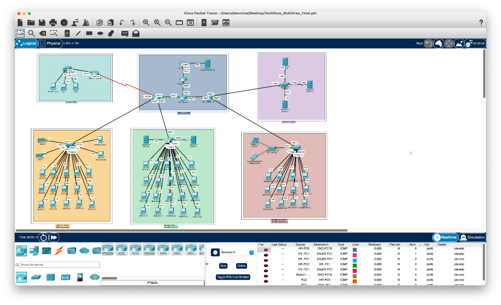

# TechNova Solutions – Enterprise Network Design & Implementation

Enterprise network design and implementation project developed as part of the **IE3140 – Advanced Network Engineering** module at the **Sri Lanka Institute of Information Technology (SLIIT)**.

---

## 📌 Project Overview
TechNova Solutions is a simulated enterprise corporate network designed and configured using **Cisco Packet Tracer**. The network architecture connects a three-floor corporate headquarters, a dedicated server farm, a simulated external ISP, and a remote branch office via WAN.

---

## 🚀 Key Technical Features
- **Hierarchical IP Addressing:** Dual-stack IPv4 subnetting using Variable Length Subnet Masking (VLSM) and IPv6 addressing.
- **VLAN & Trunking:** Logical departmental segmentation (Administration & HR, Engineering & IT, Sales & Marketing, Server Farm) with IEEE 802.1Q trunking and native VLAN isolation.
- **Inter-VLAN Routing:** Router-on-a-Stick / Switch Virtual Interfaces (SVIs) configured for seamless inter-departmental communication.
- **Dynamic Routing:** Multi-Area OSPF (Areas 0, 1, 2, 3) deployed with MD5 cryptographic authentication for secure route propagation.
- **Edge Connectivity & NAT/PAT:** Dynamic NAT with Port Address Translation (Overload) implemented on the edge router for simulated public Internet reachability.
- **Layer 2 Security Hardening:** Port Security (MAC limiting & shutdown mode), BPDU Guard on access ports, and DHCP Snooping.
- **Multicast Video Streaming:** PIM Sparse Mode (PIM-SM) and IGMP Snooping configured for company-wide video announcements.
- **Fault Recovery & Troubleshooting:** OSPF neighbor adjacency failure analysis, authentication debugging, and systematic route restoration.

---

## 📂 Repository Contents
- `TechNova_MultiArea_Final.pkt` – Working Cisco Packet Tracer topology and configuration source file.
- `configs/` – Router, switch, and end-device configuration scripts.
- `technova_packet_tracer_topology.png` – Topology overview screenshot.

---

## 💻 Requirements & Usage
1. Requires **Cisco Packet Tracer** (v8.0 or above).
2. Download or clone this repository.
3. Open `TechNova_MultiArea_Final.pkt` in Cisco Packet Tracer to inspect the network topology, CLI configurations, and routing tables.

---

## 👨‍💻 Author
- **Kushan Dewmina**
- Sri Lanka Institute of Information Technology (SLIIT)
