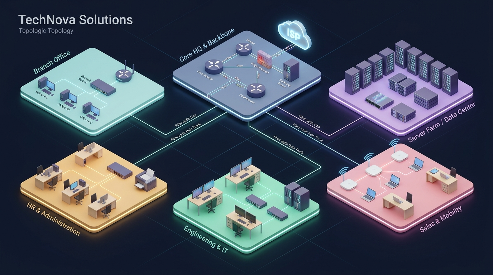

# 🌐 TechNova Solutions – Enterprise Network Architecture

Enterprise Network Design and Implementation developed using **Cisco Packet Tracer**, as part of the **IE3140 – Advanced Network Engineering** module at **Sri Lanka Institute of Information Technology (SLIIT)**.

---

## 📌 Architecture Overview

TechNova Solutions is a simulated enterprise corporate network designed across a three-floor corporate building, dedicated server infrastructure, external simulated ISP, and a remote branch office.

### 🏢 Departmental Infrastructure
- **Core HQ & Backbone:** Multi-area routing core interconnecting departmental blocks, simulated ISP, and WAN boundaries.
- **Branch Office:** Remote facility interconnected via serial WAN link.
- **Server Farm:** Dedicated subnet hosting enterprise infrastructure (DHCP, DNS, App Servers).
- **Engineering & IT (Floor 2):** High-density workstation network with departmental staging servers.
- **HR & Administration (Floor 1):** Segmented departmental LAN with printer sharing and strict access control.
- **Sales & Mobility (Floor 3):** Dual-mode network with enterprise wireless integration (WPA2).

---

## 📊 1. IPv4 Addressing Scheme (VLSM Allocation)
* **Base Network:** `192.168.1.0/24` (Optimized via Variable Length Subnet Masking)
* **Public NAT IP:** `203.0.113.5` (Configured as Dynamic PAT on Edge Router)

| Segment / Department | Min. Usable Hosts Required | Allocated Subnet | Subnet Mask | Usable Host Range | Broadcast Address | Default Gateway |
| :--- | :---: | :---: | :---: | :---: | :---: | :---: |
| **Engineering Dept (Floor 2)** | 50 | `192.168.1.0/26` | `255.255.255.192` | `192.168.1.1 - 192.168.1.62` | `192.168.1.63` | `192.168.1.1` |
| **HR Department (Floor 1)** | 30 | `192.168.1.64/27` | `255.255.255.224` | `192.168.1.65 - 192.168.1.94` | `192.168.1.95` | `192.168.1.65` |
| **Sales Department (Floor 3)** | 25 | `192.168.1.96/27` | `255.255.255.224` | `192.168.1.97 - 192.168.1.126` | `192.168.1.127` | `192.168.1.97` |
| **Branch Office LAN** | 20 | `192.168.1.128/27`| `255.255.255.224` | `192.168.1.129 - 192.168.1.158`| `192.168.1.159`| `192.168.1.129`|
| **Server Farm VLAN** | 10 | `192.168.1.160/28`| `255.255.255.240` | `192.168.1.161 - 192.168.1.174`| `192.168.1.175`| `192.168.1.161`|
| **Management VLAN** | 5 | `192.168.1.176/29`| `255.255.255.248` | `192.168.1.177 - 192.168.1.182`| `192.168.1.183`| `192.168.1.177`|
| **WAN Link (HQ to Branch)** | 2 (PtP) | `192.168.1.184/30`| `255.255.255.252` | `192.168.1.185 - 192.168.1.186`| `192.168.1.187`| `192.168.1.185`|

---

## 🌐 2. IPv6 Addressing Scheme (`2001:DB8:ACAD::/48`)
* Dual-Stack (IPv4 + IPv6) enabled on router interfaces with `/64` prefix per segment.

| Segment Name | IPv6 Subnet Prefix | Interface ID | Full Gateway IPv6 Address | Sample Host Address |
| :--- | :---: | :---: | :---: | :---: |
| **HR Department** | `2001:DB8:ACAD:1::/64` | `::1` | `2001:DB8:ACAD:1::1` | `2001:DB8:ACAD:1::10` |
| **Engineering Dept** | `2001:DB8:ACAD:2::/64` | `::1` | `2001:DB8:ACAD:2::1` | `2001:DB8:ACAD:2::10` |
| **Sales Department** | `2001:DB8:ACAD:3::/64` | `::1` | `2001:DB8:ACAD:3::1` | `2001:DB8:ACAD:3::10` |
| **Server Farm** | `2001:DB8:ACAD:4::/64` | `::1` | `2001:DB8:ACAD:4::1` | `2001:DB8:ACAD:4::10` |
| **Management VLAN** | `2001:DB8:ACAD:99::/64`| `::1` | `2001:DB8:ACAD:99::1`| `2001:DB8:ACAD:99::10`|
| **WAN Link (HQ-Branch)**| `2001:DB8:ACAD:A001::/64`| `::1` | `2001:DB8:ACAD:A001::1` | `2001:DB8:ACAD:A001::2` |
| **Branch Office LAN**| `2001:DB8:ACAD:20::/64`| `::1` | `2001:DB8:ACAD:20::1`| `2001:DB8:ACAD:20::10`|

---

## 🏷️ 3. Switching & VLAN Design

| VLAN ID | VLAN Name | Purpose / Department | Native VLAN on Trunks | Inter-VLAN Method |
| :---: | :---: | :--- | :---: | :--- |
| **10** | `HR` | Human Resources Department (Floor 1) | **999** (Security hardening) | Router-on-a-Stick / SVI |
| **20** | `Engineering` | Engineering Department (Floor 2) | **999** | Router-on-a-Stick / SVI |
| **30** | `Sales` | Sales Department & Wireless (Floor 3) | **999** | Router-on-a-Stick / SVI |
| **40** | `Servers` | Server Farm / Data Center | **999** | Router-on-a-Stick / SVI |
| **99** | `Management` | Out-of-Band Network Management | **999** | Switch Virtual Interfaces (SVI) |
| **999** | `Native` | Dedicated Native VLAN for 802.1Q Trunks | **999** | Untagged Trunk Traffic Isolation |

---

## 🔄 4. Multi-Area OSPF Routing Architecture

| OSPF Area | Area Type | Covered Networks / Locations | Routers Involved | Authentication |
| :---: | :---: | :--- | :--- | :---: |
| **Area 0** | **Backbone Area** | Core Transit Links, HQ Core Router, ISP Edge | `HQ Core Router`, `Edge Router`, `R4-AREA0` | **MD5** |
| **Area 1** | **Standard Area** | Floor 1 (HR) & Floor 2 (Engineering) Networks | `HQ Core Router` (ABR) | **MD5** |
| **Area 2** | **Standard Area** | Floor 3 (Sales) & Server Farm (Servers) | `R4-AREA0` (ABR) | **MD5** |
| **Area 3** | **Standard Area** | Remote Branch Office Network & Serial Link | `HQ Core Router` (ABR), `Branch Router` | **MD5** |

---

## 🛡️ 5. Network Security & Multicast Implementation

- **Layer 2 Security Measures:**
  - **Port Security:** Max 2 MAC addresses per access port, violation mode set to `shutdown`.
  - **BPDU Guard:** Enabled across all edge access ports to suppress rogue switch injections.
  - **DHCP Snooping:** Activated across all VLANs with trusted upstream uplinks.
- **Multicast Video Streaming:**
  - **Protocol:** Protocol Independent Multicast - Sparse Mode (PIM-SM) configured across all routers.
  - **Multicast Group:** `239.1.1.1`
  - **IGMP & IGMP Snooping:** IGMP enabled on receiver-facing interfaces; IGMP Snooping active on Layer 2 switches.

---

## 📂 Repository Contents
- `TechNova_MultiArea_Final.pkt` - Cisco Packet Tracer configuration and topology source file.
- `technova_network_topology_3d.jpg` - High-resolution 3D Network Topology Architecture Graphic.
- `README.md` - Complete technical project documentation and addressing specifications.

---

## 👨‍💻 Author
- **Kushan Dewmina**
- Sri Lanka Institute of Information Technology (SLIIT)
